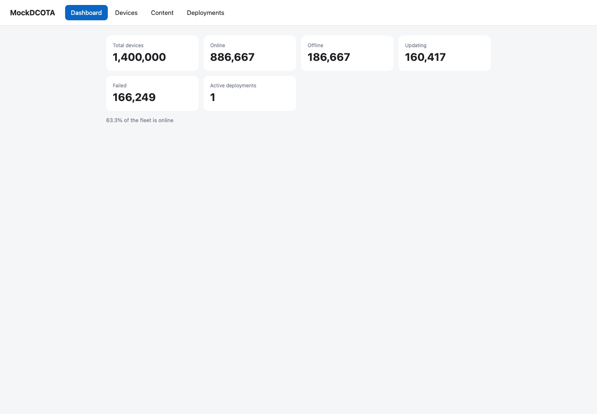
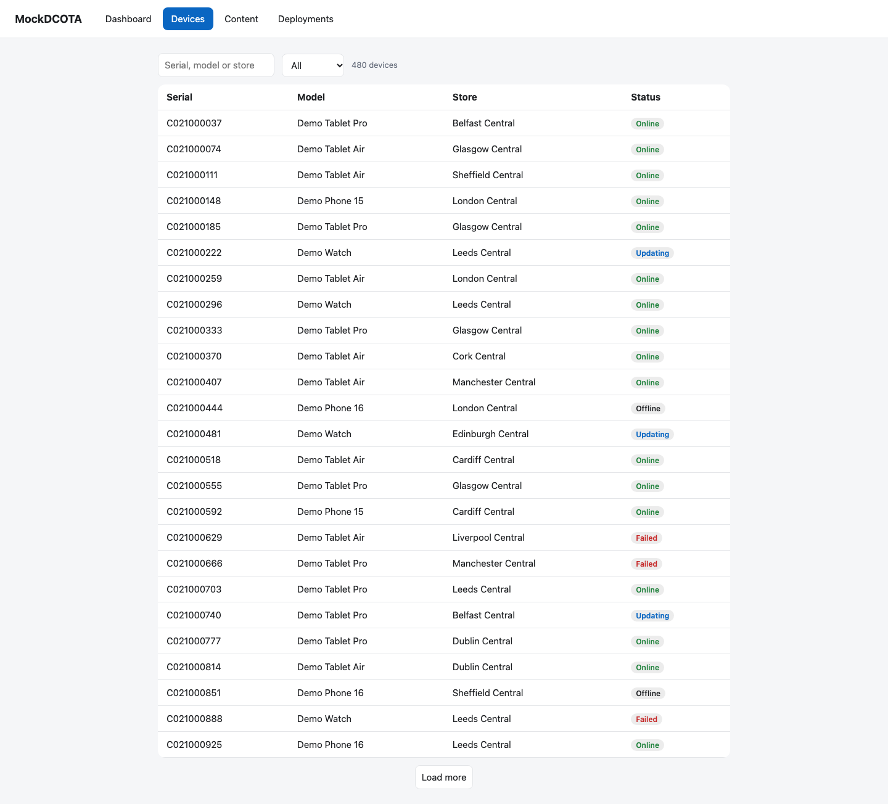
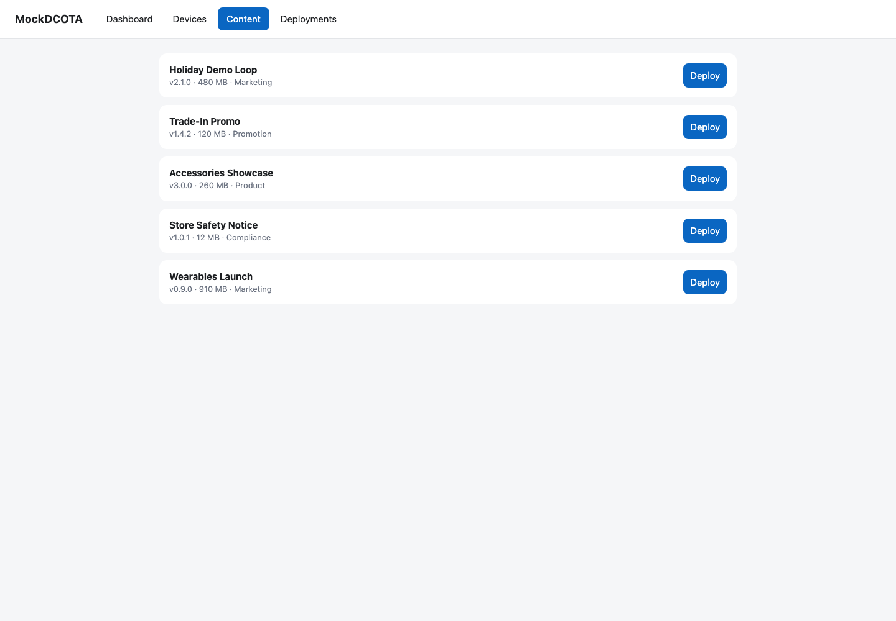
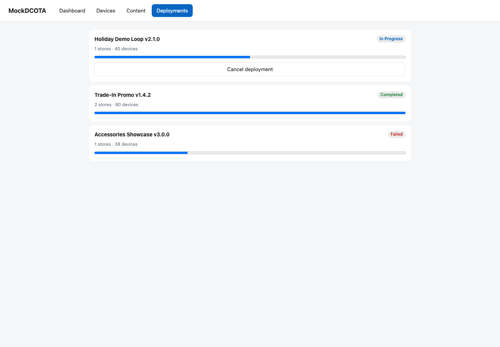

# MockDCOTA Quality Engineering

[](https://github.com/GB-A/MockDCOTA/actions/workflows/playwright.yml)

MockDCOTA is a compact iOS and web application simulating digital content management for a partner-store device fleet. This repository emphasizes testability and cross-platform UI quality through Playwright and XCUITest page-object suites.

## Application screens

| Fleet dashboard | Devices |
|---|---|
|  |  |

| Content packages | Deployments |
|---|---|
|  |  |

## Test status

**Latest local Playwright run:** ✅ **48 passed · 0 failed**  
**Run date:** 2026-10-22 · **Browsers:** Chromium, Firefox, WebKit · **Scenarios:** 16

The count represents 16 Playwright scenarios executed in each of three browser projects. The GitHub Actions badge above reports the latest remote workflow status after the workflow has run. XCUITest is included in the repository but was not part of this Playwright run.

## Implemented UI test cases

| Area | Test cases |
|---|---|
| Dashboard | **DASH-01** Fleet total; **DASH-02** status counts reconcile; **DASH-03** online percentage; **DASH-07** error banner and Retry recovery; **DASH-08** slow-backend loading; **DASH-09** empty fleet |
| Devices | **DEV-01** first page and total; **DEV-02** load next page; **DEV-03** hide Load more at end; **DEV-05** partial serial search; **DEV-06** case-insensitive search; **DEV-08** no-match empty state; **DEV-10** status filters; status-filtered device details |
| Deployments | Reject duplicate active deployment; create a deployment and cancel an active deployment |
| iOS | XCUITest dashboard smoke journey for fleet total and online-percentage visibility |

The broader scenario inventory is tracked in [MockDCOTA_Testcases.csv](MockDCOTA_Testcases.csv). Both UI suites use page objects. The web `data-testid` values mirror the iOS accessibility identifiers in `Support/AccessibilityID.swift`, keeping selectors stable and vocabulary consistent across platforms.

## Run Playwright

Requirements: Node.js 20 or later.

```bash
cd mock-server
npm ci
npx playwright install
npm test
```

Playwright starts the mock server automatically and runs Chromium, Firefox, and WebKit. Run a focused suite with:

```bash
npx playwright test tests/dashboard.spec.ts
npx playwright test tests/devices.spec.ts
npx playwright test tests/deployments.spec.ts
```

## Run XCUITest

Requirements: Xcode and an available iOS Simulator.

```bash
xcodebuild test \
  -project MockDCOTA.xcodeproj \
  -scheme MockDCOTA \
  -destination 'platform=iOS Simulator,name=<available simulator>'
```

The UI test target skips onboarding and uses the in-memory backend. Find available simulators with `xcrun simctl list devices available`.

## Testability and CI

- The app and web console cover a fleet dashboard, device search, content packages, and deployments.
- The mock API provides deterministic seed data, reset and empty/error/slow scenario hooks, and injected failures.
- The dashboard models 1.4 million devices; the device table uses a seeded 480-device sample.
- GitHub Actions runs the Playwright suite on pushes and pull requests targeting `main` or `master`, across three browser engines, and uploads the HTML report.
- The iOS workflow builds the app for Simulator. XCUITest currently runs locally using the command above.

Start the web console and REST API independently at `http://localhost:8080` with:

```bash
node mock-server/server.js
```

The API contract is documented in [mock-server/openapi.yaml](mock-server/openapi.yaml).

## AI-assisted test engineering

GitHub Copilot assisted with app/test setup and Playwright page-object and scenario scaffolding. It helped inspect app flows, selectors, and backend hooks; configure repeatable server startup and CI; and turn acceptance scenarios into measurable assertions. Generated changes were reviewed against the source and validated by running the browser tests. AI assistance complemented, rather than replaced, test execution and engineering review.

## Project map

- `MockDCOTAUITests/` — Swift UI tests and iOS page object
- `mock-server/tests/` — Playwright specs and web page objects
- `mock-server/web/` — web console under test
- `Services/`, `ViewModels/`, `Models/` — iOS application layers
- `MockDCOTA_Testcases.csv` — broader test scenario inventory
